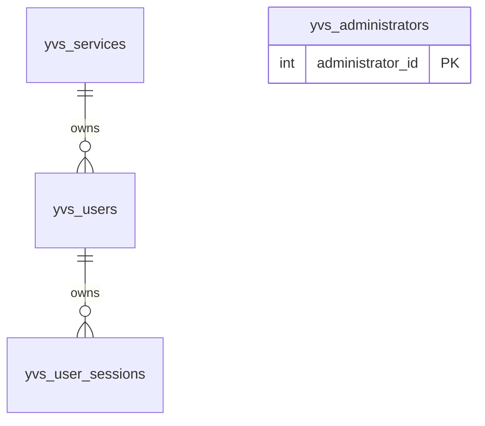

# Normalization and design choices

## Entities and relationships

These are logical relationships. MyISAM does not enforce foreign keys. Approval
requires an authenticated administrator, but an approval audit trail is outside
this minimal schema. Administrators are separate from service-owned users.

## Normalization

- **1NF:** each column has one scalar value; every row has a primary key. Sessions
  are rows, never an array/list on a user. Names, hashes and timestamps are not packed
  into JSON or delimiter-separated fields.
- **2NF:** all tables have single-column primary keys; non-key facts depend on the
  entire entity identity. There are no partial composite-key dependencies.
- **3NF:** service names/tokens live on services, user credentials on users, session
  activity on sessions. Sessions do not copy service_pk, service name or password
  data. Service ownership is resolved through the user, preventing contradictory
  copies. Public service_id and internal service_pk are alternate identifiers of
  the same entity once approved, not a separate entity needing another table.

Current and previous service credentials are two bounded protocol roles, not an
unbounded token history/repeating list. Keeping them on the service row permits
one conditional update without a transaction. Approval status has consistency
rules with nullable approval fields; enforce those state rules as documented in
[operations](operations.md). This limited state representation is intentional.

Do not store session counts, expires_at, password age or a reminder flag. Derive
these from session rows and timestamps so activity updates cannot leave stale
cached values. last_session_cleanup_at is operational metadata, not user activity.

## Keys, types and credentials

- INT UNSIGNED internal service/admin keys are compact and ample for personal usage.
  Public service/user IDs are 32 lowercase hex characters (16 random bytes). They
  are identifiers, not authentication secrets. Reject malformed input before SQL.
- Service/session bearer tokens are 64 lowercase hex characters generated from
  32 cryptographically random bytes. They remain distinct credentials.
- User sessions store only SHA-256 digests in BINARY(32). PHP hashes the bearer
  token for lookup; never expose the stored digest as the session credential.
- Current/previous service tokens use VARBINARY(64) for exact comparisons and
  recoverable redelivery of new_token. This deliberately stores bearer secrets
  recoverably: a database read compromise exposes service credentials. Restrict
  access and backups, never include values in logs/history. No application
  encryption/key-management layer is introduced for this small initial service.
  Hash-only service storage cannot redeliver the current token under the proposal.
- Passwords store PHP's complete salted password_hash output in VARBINARY(255),
  never raw passwords. PHP performs password_verify, not a SQL equality check.
- Human names use utf8mb4_unicode_ci; IDs use ascii_bin. Administrator usernames
  are normalized to lowercase ASCII by PHP before lookup/insertion.
- DATETIME holds UTC values explicitly supplied by the application. There is no
  automatic ON UPDATE that could accidentally extend a session or password age.

## Engine and scope

MyISAM is the selected conservative baseline for restricted free hosting; actual
server execution remains unverified. Its lack of foreign keys and transaction recovery means relationships
and multi-step failure handling belong to PHP; SQL constraints alone do not make
this design safe to deploy without the application checks. Table locking is
acceptable for the stated small workload. These engine properties are documented
in the [MySQL manual](https://dev.mysql.com/doc/refman/8.0/en/myisam-storage-engine.html).

No provider identities, extra credential abstraction, separate pending-request
table, admin-session table or audit history now. Default design for admin browser
sessions is private server-side PHP session storage; login/bootstrap code is still
pending. No InnoDB dependency or alternative engine migration is required now.
